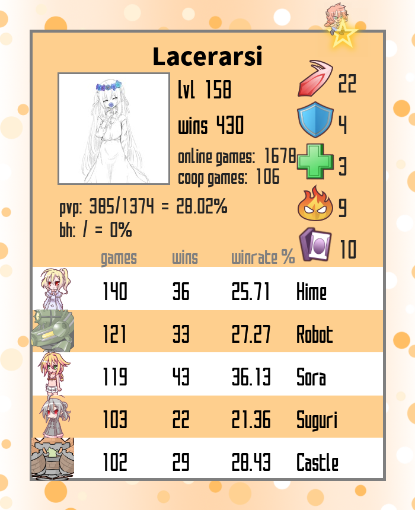
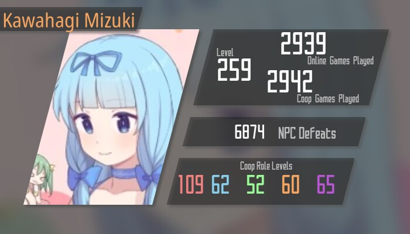
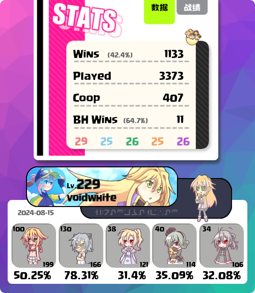

<p align="center">
    <br> <a href="README.md">English</a> | 中文
</p>
<p align="center">
    <em>百分百鲜橙汁 统计数据</em>
</p>

# 百分百鲜橙汁 统计数据
本项目的起点是 [一个远古时期的个人统计查询项目](https://gitlab.com/gabuch2/orange-juice-stats)，旧项目缺乏维护，已经难以满足其功能。
本项目是它的增强版本。

羽希在 2021 年初将其重新整理并拓展到全球统计，部署到 100oj.com 使其成为众多橙汁工具的一部分。








# 功能

| 入口 | 说明 |
| --- | --- |
| `global.php` | 全球统计：每个角色的总场数、胜场、胜率。可选择日期范围（UTC），不选则显示全部时间。 |
| `player.php` | 个人统计：等级、合作职业、角色、卡牌、赏金等数据。 |
| `render.php` | 图像 API：把个人统计渲染成 PNG 图片。 |

### 全球数据缓存
Steam 的全球统计按 UTC 日存储。除了最近两天（昨天和今天）的数据仍在变化、每次实时查询之外，
更早的每一天都是静态的：第一次查询时从 Steam 拉取，之后存入 SQLite（默认 `var/global-stats.sqlite`），
再也不用重复请求。因此日期范围没有长度限制，后端会自动按 Steam 的限制（每次最多 50 天、100 个统计项）分批并行请求。

可以用命令行预先缓存全部历史（已缓存的日期会跳过，适合放进每日 cron）：

```sh
php bin/warm-cache.php                         # 全部历史
php bin/warm-cache.php 2026-01-01 2026-06-30   # 指定范围
```

### 个人数据缓存
`player.php` 和 `render.php` 共用一份按玩家划分的文件缓存：每个玩家一个 JSON 文本文件
（默认 `var/players/<steamid>.json`），里面记录了这次查询的时间戳以及 Steam 返回的数据。
在 `player_cache_ttl`（默认 3600 秒）以内再次查询同一玩家时直接使用缓存，超过之后才重新请求 Steam。
查询失败（例如隐私设置未公开）不会被缓存。

### 图像 API
`render.php?steamid=<steamid>[&render=<0-8>][&limit=<行数>][&nick=<昵称>][&sp1=<徽章>]`

| 参数 | 说明 |
| --- | --- |
| `steamid` | 必填，[Steam64 位 ID](https://steamid.io/)，形如 7656xxxxxxxxxxxxx |
| `render` | 样式编号 0~8，默认 0 |
| `limit` | 显示的角色数量（样式 0、6、8） |
| `nick` | 自定义昵称 |
| `sp1` | 徽章编号（样式 1、2 中是昵称颜色） |
| `hyper_icon`、`y_offset` | 样式 7 的 Hyper 卡图标与裁剪偏移，偏移为负数时水平翻转 |

# 部署

## 环境要求
- PHP 8.1 或更高版本，扩展：`curl`、`gd`、`imagick`、`pdo_sqlite`
  （Debian/Ubuntu：`apt install php-curl php-gd php-imagick php-sqlite3`；Arch：`pacman -S php-gd php-imagick php-sqlite`，并在 php.ini 中启用对应扩展）
- 一个 [Steam Web API Key](https://steamcommunity.com/dev/apikey)

## 配置
复制 `config.example.php` 为 `config.php` 并填写，或者使用环境变量（环境变量优先）：

| config.php | 环境变量 | 说明 |
| --- | --- | --- |
| `steam_api_key` | `OJ_STEAM_API_KEY` | Steam Web API Key（个人统计和图像 API 需要） |
| `base_url` | `OJ_BASE_URL` | 站点的公开地址，例如 `https://stats.example.com`，用于生成可分享的链接；留空则根据请求自动推断 |
| `database` | `OJ_DATABASE` | SQLite 数据库路径，默认 `var/global-stats.sqlite` |
| `earliest_date` | `OJ_EARLIEST_DATE` | Steam 全球历史数据的第一天，默认 `2014-05-31` |
| `http_timeout` | `OJ_HTTP_TIMEOUT` | 单个 Steam API 请求的超时秒数，默认 15 |
| `player_cache_ttl` | `OJ_PLAYER_CACHE_TTL` | 个人数据缓存的有效秒数，默认 3600；0 表示不缓存 |
| `player_cache_dir` | `OJ_PLAYER_CACHE_DIR` | 个人数据缓存文件的目录，默认 `var/players` |

`var/` 目录需要对 PHP 进程可写。

## 运行
Web 根目录是 `public/`，其余目录（配置、源码、数据库）都不会暴露给外部。

本地开发：

```sh
php -S 127.0.0.1:8000 -t public
```

生产环境可以参考与本项目同级目录下的 `Caddyfile`（Caddy + php-fpm）。

## 或者用 Docker
[OrangeJuice-Stats-Docker](https://github.com/Hanekihyouka/OrangeJuice-Stats-Docker)（注意：Web 根目录已改为 `public/`）。

# 项目结构

```
public/      Web 根目录：页面入口、css/js、图片
src/         PHP 代码（命名空间 OJStats\）
  Steam/       Steam Web API 客户端
  Stats/       个人统计、全球统计与 SQLite 缓存
  Render/      图像 API，Themes/ 下是各个样式
  Game/        角色、合作职业等游戏数据模型
templates/   页面模板
data/        角色、卡牌、赏金 NPC、统计项说明等数据表
resources/   渲染用的字体和各样式的素材
bin/         命令行工具
var/         运行时数据（SQLite 数据库、个人数据缓存）
```

新增角色时，在 `data/characters.php` 加一行，并把图片放进 `public/images/` 对应的目录即可。

## License
沿用旧项目的 [GNU Affero General Public License v3.0](https://www.gnu.org/licenses/agpl-3.0.en.html)
