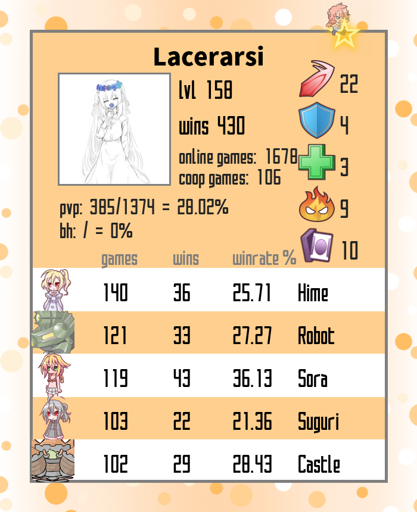
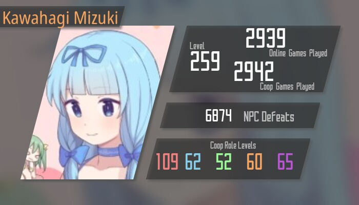
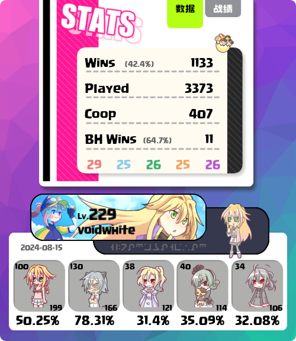

<p align="center">
    <br> English | <a href="README-CN.md">中文</a>
</p>
<p align="center">
    <em>100% Orange Juice Stats</em>
</p>

# 100% Orange Juice Stats
This project is an enhanced version of [orange-juice-stats](https://gitlab.com/gabuch2/orange-juice-stats).

I built this repo to make it easier to look up global stats and player stats,
and deployed it on 100oj.com in early 2021 as part of the many Orange Juice tools available.








# Features

| Entry | Description |
| --- | --- |
| `global.php` | Global stats: games, wins and win rate of every character, for all time or a range of (UTC) days. |
| `player.php` | Player stats: level, co-op roles, characters, cards, bounties... |
| `render.php` | Image API: a player's stats rendered as PNG. |

### Global stats cache
Steam buckets global stats by UTC day. The two most recent days (yesterday and today) are still changing
and are always requested live. Every older day is static: it is fetched from Steam once and then stored in
SQLite (`var/global-stats.sqlite` by default). Date ranges therefore have no length limit; requests are
split automatically to fit Steam's limits (50 days and 100 stats per call) and run in parallel.

The whole history can be cached ahead of time (cached days are skipped, so it is fine for a daily cron job):

```sh
php bin/warm-cache.php                         # whole history
php bin/warm-cache.php 2026-01-01 2026-06-30   # a range
```

### Player data cache
`player.php` and `render.php` share a per-player file cache: one JSON text file per player
(`var/players/<steamid>.json` by default) holding the time of the query and Steam's data.
Within `player_cache_ttl` (3600 seconds by default) the cached data is used; after that Steam is
queried again. Failed queries (e.g. private profiles) are not cached.

### Image API
`render.php?steamid=<steamid>[&render=<0-8>][&limit=<rows>][&nick=<name>][&sp1=<pin>]`

| Parameter | Description |
| --- | --- |
| `steamid` | required, your [SteamID64](https://steamid.io/), like 7656xxxxxxxxxxxxx |
| `render` | style 0~8, default 0 |
| `limit` | number of character rows (styles 0, 6, 8) |
| `nick` | nickname override |
| `sp1` | pin badge (nickname colour for styles 1 and 2) |
| `hyper_icon`, `y_offset` | hyper card icon / crop offset of style 7; a negative offset mirrors it |

# Setup

## Requirements
- PHP 8.1+ with `curl`, `gd`, `imagick` and `pdo_sqlite`
  (Debian/Ubuntu: `apt install php-curl php-gd php-imagick php-sqlite3`; Arch: `pacman -S php-gd php-imagick php-sqlite` and enable them in php.ini)
- A [Steam Web API key](https://steamcommunity.com/dev/apikey)

## Configuration
Copy `config.example.php` to `config.php`, or use environment variables (they take precedence):

| config.php | Environment | Description |
| --- | --- | --- |
| `steam_api_key` | `OJ_STEAM_API_KEY` | Steam Web API key (needed for player stats and images) |
| `base_url` | `OJ_BASE_URL` | Public URL of the site, e.g. `https://stats.example.com`, used for shareable links; empty = derive from the request |
| `database` | `OJ_DATABASE` | SQLite database path, default `var/global-stats.sqlite` |
| `earliest_date` | `OJ_EARLIEST_DATE` | First day of global history on Steam, default `2014-05-31` |
| `http_timeout` | `OJ_HTTP_TIMEOUT` | Timeout in seconds of one Steam API request, default 15 |
| `player_cache_ttl` | `OJ_PLAYER_CACHE_TTL` | Seconds a player's data is cached, default 3600; 0 disables the cache |
| `player_cache_dir` | `OJ_PLAYER_CACHE_DIR` | Directory of the player cache files, default `var/players` |

`var/` must be writable by PHP.

## Running
The web root is `public/`; configuration, code and database stay outside of it.

Development:

```sh
php -S 127.0.0.1:8000 -t public
```

For production see the `Caddyfile` next to this project (Caddy + php-fpm).

## Or use docker
see [OrangeJuice-Stats-Docker](https://github.com/Hanekihyouka/OrangeJuice-Stats-Docker) (note: the web root is now `public/`).

# Layout

```
public/      web root: pages, css/js, images
src/         PHP code (namespace OJStats\)
  Steam/       Steam Web API client
  Stats/       player stats, global stats and their SQLite cache
  Render/      image API, one class per style in Themes/
  Game/        characters, co-op roles
templates/   page templates
data/        characters, cards, bounty NPCs, stat descriptions
resources/   fonts and artwork used by the renders
bin/         command line tools
var/         runtime data (SQLite database, player cache)
```

To add a character, add a line to `data/characters.php` and put its images in `public/images/`.

## License
[GNU Affero General Public License v3.0](https://www.gnu.org/licenses/agpl-3.0.en.html)
